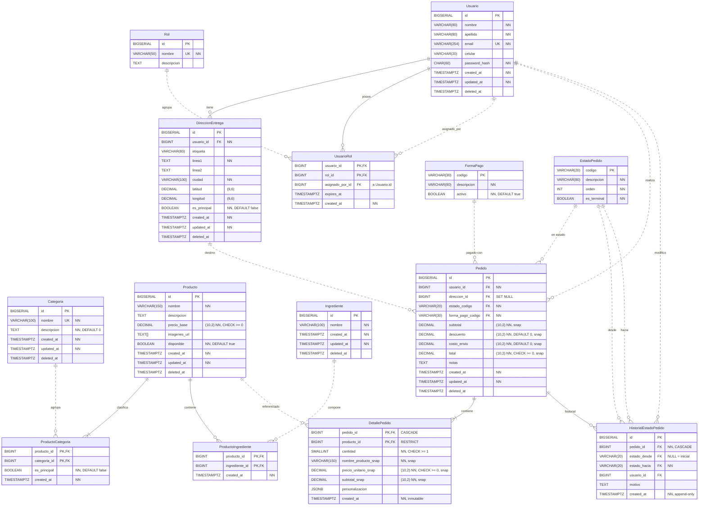

# Sistema de pedidos de comida — ERD

v3.0 · 3FN · Soft-delete · Snapshot · Audit Trail · FK explícitas

## Notación

| Mermaid             | UML original      | Significado                       |
| ------------------- | ----------------- | --------------------------------- |
| línea continua `--` | `*--` composición | `ON DELETE CASCADE`               |
| línea punteada `..` | `o--` asociación  | `ON DELETE RESTRICT` / `SET NULL` |
| `\|\|--o{`          | `"1" -- "0..*"`   | uno a cero o más                  |
| `\|\|--\|{`         | `"1" -- "1..*"`   | uno a uno o más                   |

Los tipos `DECIMAL` llevan la precisión en el comentario porque Mermaid no admite comas en el tipo.
Estereotipos: **Table** entidad mutable · **Link** tabla pivot N:M · **Catalog** catálogo de referencia.

## Diagrama

## Dominios

| Dominio                | Tablas                                                                                                                      |
| ---------------------- | --------------------------------------------------------------------------------------------------------------------------- |
| Identidad & Acceso     | `Usuario` (Table), `Rol` (Catalog), `UsuarioRol` (Link), `DireccionEntrega` (Table)                                         |
| Catálogo de Productos  | `Categoria` (Table), `Producto` (Table), `ProductoCategoria` (Link), `Ingrediente` (Table), `ProductoIngrediente` (Link)    |
| Ventas & Transacciones | `FormaPago` (Catalog), `EstadoPedido` (Catalog), `Pedido` (Table), `DetallePedido` (Table), `HistorialEstadoPedido` (Table) |

## Notas

**Producto**: stock excluido, pertenece al dominio INVENTARIO (SRP).

**Ingrediente**: el nombre es único entre los ingredientes activos (se valida en el servicio, no en la DB, por el soft delete). No se puede eliminar mientras esté asociado a un producto activo.

**ProductoIngrediente**: tabla pivot N:M sin `updated_at`. Al quitar un ingrediente de un producto la fila se borra físicamente.

**EstadoPedido**: valores del catálogo.

| codigo     | orden | es_terminal |
| ---------- | ----- | ----------- |
| PENDIENTE  | 1     | false       |
| CONFIRMADO | 2     | false       |
| EN_PREP    | 3     | false       |
| EN_CAMINO  | 4     | false       |
| ENTREGADO  | 5     | **true**    |
| CANCELADO  | 6     | **true**    |

**DetallePedido**: fila inmutable, sin `updated_at`. `personalizacion` es un JSONB con los ingredientes removidos/agregados.

**HistorialEstadoPedido**:

- Append-only: solo INSERT, nunca UPDATE ni DELETE.
- `estado_desde = NULL`: transición inicial.
- Reconstruir: `ORDER BY created_at ASC`.
- Validar `es_terminal` antes del INSERT.
