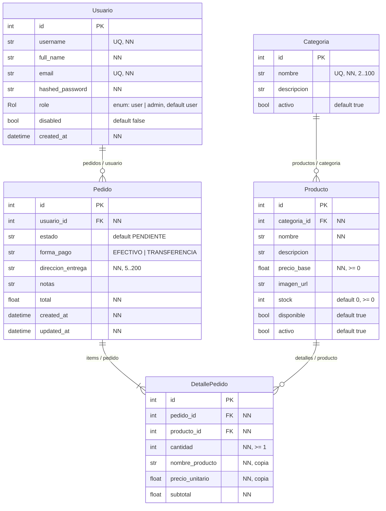
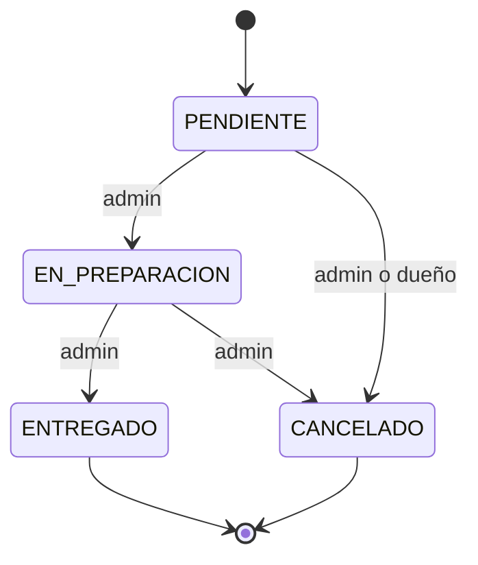

# Food Store: modelo de datos

Reproduce el diagrama UML de la consigna (UML_FOOD_STORE). Las restricciones de largo y rango (`>= 0`, `2..100`) se validan en los schemas y en el Service, no con CHECK en la base.

## Diagrama

## Relaciones

| Relación                   | Atributos                                  |
| -------------------------- | ------------------------------------------ |
| Categoria 1:N Producto     | `Categoria.productos` y `Producto.categoria` |
| Usuario 1:N Pedido         | `Usuario.pedidos` y `Pedido.usuario`       |
| Pedido 1:N DetallePedido   | `Pedido.items` y `DetallePedido.pedido`    |
| Producto 1:N DetallePedido | `Producto.detalles` y `DetallePedido.producto` |

## Reglas

- **Baja lógica**: `Usuario.disabled`, `Categoria.activo` y `Producto.activo`. Los pedidos no se borran: se cancelan.
- La baja de una categoría no libera su nombre ni oculta sus productos.
- Un producto se vende solo si está activo, disponible y con `stock >= cantidad` (RN-01).
- El stock se descuenta al crear el pedido (RN-01) y se restituye al cancelarlo (RN-03), en la misma transacción.
- `DetallePedido` es inmutable: copia `nombre_producto` y `precio_unitario`, y `subtotal = precio_unitario × cantidad`. `Pedido.total` es la suma de los subtotales y no cambia (RN-05).
- Un producto no se repite en el mismo pedido (RN-01).

## Estados del pedido (RN-02)

